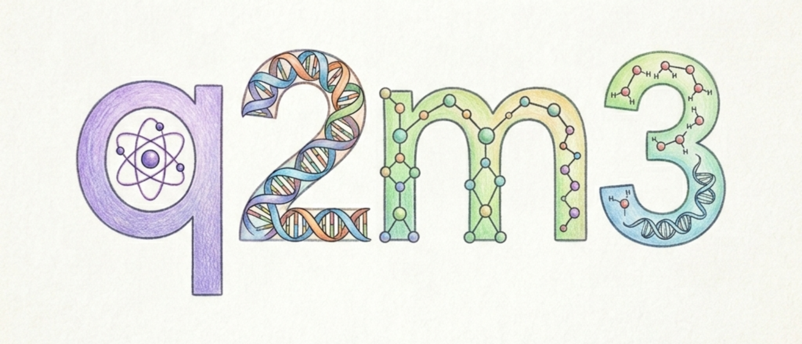

# q2m3：量子经典混合 QM/MM 模拟框架

[English](README.md) | [简体中文](README_CN.md)

<p align="center">
  
</p>

[](https://www.python.org/downloads/)
[](https://opensource.org/licenses/MIT)
[](https://github.com/yjmaxpayne/q2m3/actions/workflows/docs.yml)
[](https://yjmaxpayne.github.io/q2m3/zh_CN/)
[](https://codecov.io/gh/yjmaxpayne/q2m3)
[](https://doi.org/10.5281/zenodo.20114945)
[](https://pennylane.ai/)
[](https://github.com/PennyLaneAI/catalyst)
[](https://pyscf.org/)

q2m3 是用于量子经典混合 QM/MM（量子力学 / 分子力学）的研究框架。
它将 PySCF 分子积分和 Hartree–Fock 参考态连接到 PennyLane 量子相位估计（QPE）电路，
还支持显式 MM 点电荷、蒙特卡洛（MC）溶剂化和基于采样的量子对角化（SQD）。

q2m3 可用于小分子 QPE 工作流和早期容错量子计算（EFTQC）资源估计。
项目目前处于 alpha 概念验证阶段。现有近似和小体系检查不足以证明其具备生产级化学精度。

## 安装

q2m3 要求 Python 3.11+。使用库时可从 PyPI 安装。运行示例脚本和开发工具时，请使用源码仓库。

### 从 PyPI 安装

在 POSIX shell 的虚拟环境中执行：

```bash
python -m venv .venv
source .venv/bin/activate
python -m pip install q2m3
```

PyPI 包页面：[q2m3](https://pypi.org/project/q2m3/)。

### 从源码安装

先安装 [uv](https://docs.astral.sh/uv/getting-started/installation/)，再执行：

```bash
git clone https://github.com/yjmaxpayne/q2m3.git
cd q2m3
uv sync
```

核心安装支持[示例指南](examples/README.md)中的三个 H₂ 入门脚本。按用途选择可选依赖：

| 可选依赖 | 用途 |
| --- | --- |
| `solvation` | 蒙特卡洛工作流，包含 Catalyst 和 JAX |
| `catalyst` | 电路编译，无须安装完整溶剂化依赖 |
| `gpu` | GPU 依赖，要求兼容的 NVIDIA/CUDA 环境 |
| `viz` | 分子可视化工具 |
| `dev` / `docs` | 测试和代码质量工具 / Sphinx 文档 |
| `sqd` | ffsim/Qiskit SQD 工作流，参见 [SQD 指南](https://yjmaxpayne.github.io/q2m3/zh_CN/sqd.html) |

例如，在源码仓库中运行 `uv sync --extra solvation`。
在使用库的环境中运行 `python -m pip install "q2m3[solvation]"`。

## 最小 Python API 示例

以下代码估计 H₂/STO-3G 的资源。活性空间包含两个电子和两个空间轨道，
对应四个 Jordan–Wigner 系统量子比特。坐标单位为 Å，目标能量误差单位为 Hartree。
在 PyPI 安装环境中用 `python` 执行。在源码仓库中用 `uv run python` 执行。

```python
import numpy as np

from q2m3.core import estimate_resources

resources = estimate_resources(
    symbols=["H", "H"],
    coords=np.array([[0.0, 0.0, 0.0], [0.0, 0.0, 0.74]]),
    basis="sto-3g",
    active_electrons=2,
    active_orbitals=2,
    target_error=0.0016,
)
print("System qubits:", resources.n_system_qubits)
print("Logical qubits:", resources.logical_qubits)
print("Toffoli gates:", resources.toffoli_gates)
```

`estimate_resources` 返回 `EFTQCResources` 对象。
逻辑量子比特数和 Toffoli 门数来自算法成本模型，不能预测本地模拟器运行时间或 Catalyst 编译内存。

## SQD 工作流

在源码仓库中运行 `uv sync --frozen --extra sqd` 安装 SQD 依赖。
SQD 不要求 Catalyst。公开的监督执行器要求 Linux x86_64 和串行原生线程。
统一锁文件也将仅安装核心依赖时的 PySCF 版本更新为 2.14.0。
校准资源配置使用 Python 3.12.3。

SQD 提供两个入口：

- `from q2m3 import run_sqd` 从分子几何结构开始。
- `from q2m3.sqd import run_sqd_from_integrals` 从经过认证的积分哈密顿量和同轨道框架的 CCSD 种子开始。

两个函数都要求显式指定闭壳层活性空间，并返回完整的 `SQDResult`。
[SQD 指南](https://yjmaxpayne.github.io/q2m3/zh_CN/sqd.html)提供两个入口的可运行示例，
并说明固定轨道框架下的 MM 嵌入、参考层级、安装要求和资源上限。
[SQD API 参考](https://yjmaxpayne.github.io/q2m3/zh_CN/api-reference/sqd.html)
列出公开契约、经过认证的积分生成函数和资源策略函数。

当前证据支持默认基准范围：两次重复和 100000 次采样。
H₂ 和 H₃O⁺ 是全空间回归检查。甘氨酸的五个种子结果均差于 CCSD。
N₂ 结果差于 CCSD，也差于匹配子空间大小的 SCI。
原始轨道基底（E1）和连通性（E6）研究仍无定论。
历史上的四次重复运行仍处于已认证资源域之外。
这些结果不能证明 SQD 更优，也不能证明其已具备量子硬件运行条件。

## 示例与文档

从[示例指南](examples/README.md)开始。指南提供可运行的 H₂ 命令和完整脚本索引，
并标明 MC 工作流及较大规模的诊断脚本。

| 目标 | 入口 |
| --- | --- |
| 验证真空及 MM 嵌入 QPE | [H₂ QPE 教程](https://yjmaxpayne.github.io/q2m3/zh_CN/tutorials/h2-qpe-validation.html) |
| 比较资源估计 | [H₂ 资源教程](https://yjmaxpayne.github.io/q2m3/zh_CN/tutorials/h2-resource-estimation.html) |
| 探索固定分子轨道嵌入 | [完整单电子嵌入示例](examples/qmmm/full_oneelectron_embedding.py) |
| 运行蒙特卡洛溶剂化 | [H₂ MC 教程](https://yjmaxpayne.github.io/q2m3/zh_CN/tutorials/h2-mc-solvation.html) |
| 完整运行采样对角化 | [从 H₂ 到甘氨酸的 SQD 教程](https://yjmaxpayne.github.io/q2m3/zh_CN/tutorials/sqd-showcase.html) |
| 理解模型与 API | [中文文档站点](https://yjmaxpayne.github.io/q2m3/zh_CN/) |

q2m3 使用 Hartree 计算能量，并在以 kcal/mol 报告前显式转换单位。
QPE–HF 差值同时包含数值误差和电子相关贡献。
固定分子轨道（fixed-MO）MM 嵌入保持真空轨道框架和双电子张量不变。
MC 运行时仅更新对角系数。解释能量的物理意义前，请先阅读各示例的适用边界。

### 可运行功能索引

| 目标 | 学习路径 |
| --- | --- |
| QPE 验证与分辨率 | [QPE 示例](examples/qpe/README.md) |
| SQD 基态与规模扩展 | [H₂ → 甘氨酸 CAS 6/8/10 → 积分](examples/sqd/README.md) |
| 固定分子轨道嵌入与 QPE–MC | [QM/MM 示例](examples/qmmm/README.md) |
| 量子资源估计 | [资源示例](examples/resources/README.md) |
| Catalyst 与编译成本 | [性能示例](examples/performance/README.md) |

SQD 教程将完整结果、CSV 文件和 PNG/SVG 图保存到 `data/output/examples/` 下的独立运行目录。
默认甘氨酸扫描按顺序实际运行 15 个点，每个点都使用新的进程。
本地开发工具不属于安装包，新克隆的仓库也不要求这些工具。
使用 `q2m3.profiling.measure_command` 监测完整进程。
[SQD 教程](https://yjmaxpayne.github.io/q2m3/zh_CN/tutorials/sqd-showcase.html#4-verify-the-integral-adapter)
说明结果契约、单位、默认环境和采样限制。
历史基准和校准记录描述其原始输入及版本。共享 CI 不保证重新生成这些研究。

## 开发、引用与许可证

[开发指南](https://yjmaxpayne.github.io/q2m3/zh_CN/development.html)列出测试、检查和构建命令。
贡献约定见 [AGENTS.md](AGENTS.md)。请勿提交生成的覆盖率文件、缓存或基准输出。

用于研究时，请引用生成结果所用的发布版本。
引用元数据见 [CITATION.cff](CITATION.cff)。q2m3 使用 [MIT 许可证](LICENSE)。
